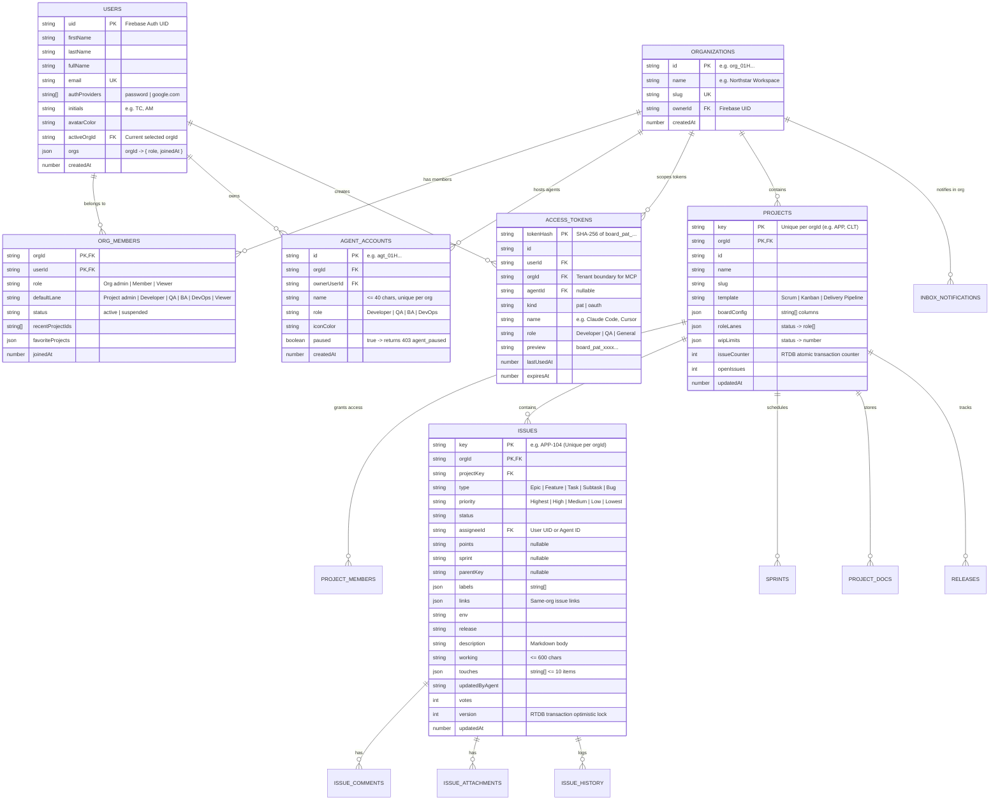

# 02 — โครงสร้างฐานข้อมูลแพลตฟอร์มบน Firebase Realtime Database (Multi-Tenant RTDB Schema)

ระบบใช้ **Firebase Realtime Database (RTDB)** โดยแยกข้อมูลออกเป็น 3 ส่วนหลักในระดับ Root:
1. **`/users/{uid}`**: ข้อมูลบัญชีผู้ใช้ระดับแพลตฟอร์ม (เชื่อมกับ Firebase Auth UID) และรายชื่อ Organization ที่ผู้ใช้นั้นสังกัดอยู่ (`orgs`)
2. **`/access_tokens/{tokenHash}`**: ดัชนีค้นหา Token ของ MCP (`board_pat_...` และ OAuth) เพื่อระบุว่า Token นี้เป็นของ `userId` ใด และผูกกับ `orgId` ใด
3. **`/orgs/{orgId}/...`**: ข้อมูลทั้งหมดของแต่ละ Organization / Workspace (สมาชิก, Agents, โปรเจกต์, Issues, Sprints, Docs, Releases และ Inbox)

---

## 1. โครงสร้าง JSON Tree บน Firebase Realtime Database

```text
/
├── users/
│   └── {uid}/                                  # uid จาก Firebase Authentication (Email/Password หรือ Third-Party Login)
│       ├── id: "usr_01H..."
│       ├── email: "thanet@northstar.studio"
│       ├── firstName: "Thanet"
│       ├── lastName: "Chankhua"
│       ├── fullName: "Thanet Chankhua"
│       ├── initials: "TC"
│       ├── avatarColor: "avatar-mint"
│       ├── authProviders: ["password", "google.com"]
│       ├── activeOrgId: "org_01H..."           # Organization ที่ผู้ใช้เปิดใช้งานอยู่ล่าสุด
│       ├── orgs:                               # รายชื่อ Organization ที่ผู้ใช้นี้เป็นสมาชิก
│       │   └── {orgId}: { role: "Org admin", joinedAt: 1732380000000 }
│       └── createdAt: 1732380000000
│
├── access_tokens/
│   └── {tokenHash}/                            # SHA-256 ของ board_pat_... หรือ OAuth token
│       ├── id: "tok_01H..."
│       ├── userId: "{uid}"                     # เจ้าของ Token
│       ├── orgId: "{orgId}"                    # ขอบเขต Organization ที่ Token นี้เข้าถึงได้
│       ├── agentId: "{agentId}"                # null หากเป็น Personal Token, มีค่าเมื่อผูกกับ Agent Account
│       ├── kind: "pat"                         # pat | oauth
│       ├── name: "Claude Code"
│       ├── role: "Developer"
│       ├── preview: "board_pat_7f8a..."
│       ├── lastUsedAt: 1732380000000
│       └── expiresAt: 1740000000000
│
├── org_invites/
│   └── {inviteToken}/
│       ├── orgId: "{orgId}"
│       ├── email: "teammate@example.com"
│       ├── role: "Member"
│       ├── defaultLane: "Developer"
│       ├── invitedBy: "{uid}"
│       └── expiresAt: 1733000000000
│
└── orgs/
    └── {orgId}/                                # ขอบเขตของแต่ละ Organization / Workspace บนแพลตฟอร์ม
        ├── info/
        │   ├── id: "org_01H..."
        │   ├── name: "Northstar Workspace"
        │   ├── slug: "northstar-workspace"
        │   ├── ownerId: "{uid}"
        │   └── createdAt: 1732380000000
        │
        ├── members/
        │   └── {uid}/
        │       ├── userId: "{uid}"
        │       ├── role: "Org admin"           # Org admin | Member | Viewer
        │       ├── defaultLane: "Developer"    # Project admin | Developer | QA | BA | DevOps | Viewer
        │       ├── status: "active"            # active | suspended (ระงับเฉพาะใน Org นี้ -> Pause Agent ใน Org นี้)
        │       ├── recentProjectIds: ["app", "client", "mobile"]
        │       ├── favoriteProjects: { "app": true, "mobile": true }
        │       └── joinedAt: 1732380000000
        │
        ├── agent_accounts/
        │   └── {agentId}/                      # e.g. agt_01H...
        │       ├── id: "agt_01H..."
        │       ├── orgId: "{orgId}"
        │       ├── ownerUserId: "{uid}"
        │       ├── name: "release-agent-1"     # ชื่อไม่ซ้ำภายใน orgId เดียวกัน (<= 40 chars)
        │       ├── role: "Developer"
        │       ├── iconColor: "symbol-green"
        │       ├── paused: false               # true -> คืน 403 agent_paused ทันที
        │       └── createdAt: 1732380000000
        │
        ├── agent_runs/
        │   └── {agentId}/
        │       └── {runId}/
        │           ├── id: "run_01H..."
        │           ├── goal: "Implement passkey login for APP-104"
        │           ├── tool: "transition_issue"
        │           ├── projectKey: "APP"
        │           ├── targetKey: "APP-104"
        │           ├── reason: "Moved to In Progress"
        │           ├── aiClient: "Claude Code"
        │           └── at: 1732380000000
        │
        ├── projects/
        │   └── {projectKey}/                   # e.g. "APP", "CLT" (ไม่ซ้ำภายใน orgId เดียวกัน)
        │       ├── id: "app"
        │       ├── orgId: "{orgId}"
        │       ├── key: "APP"
        │       ├── name: "Storefront refresh"
        │       ├── slug: "storefront-refresh"
        │       ├── template: "Kanban"          # Scrum | Kanban | Delivery Pipeline
        │       ├── boardConfig: ["Backlog", "To Do", "In Progress", "In Review", "Testing (UAT)", "Done"]
        │       ├── roleLanes: { "In Progress": ["Developer"], "In Review": ["QA"] }
        │       ├── wipLimits: { "In Progress": 5 }
        │       ├── issueCounter: 126           # ใช้ RTDB transaction() บวกเพิ่มทีละ 1 ตอนสร้าง Issue ใหม่
        │       ├── openIssues: 7
        │       ├── color: "symbol-green"
        │       ├── updatedAt: 1732380000000
        │       └── members:
        │           └── {uid}: { role: "Project admin", lane: "Developer" }
        │
        ├── issues/
        │   └── {projectKey}/
        │       └── {issueKey}/                 # e.g. "APP-104"
        │           ├── id: "auth"
        │           ├── key: "APP-104"
        │           ├── projectKey: "APP"
        │           ├── type: "Feature"         # Epic | Feature | Task | Subtask | Bug
        │           ├── priority: "High"        # Highest | High | Medium | Low | Lowest
        │           ├── status: "In Progress"
        │           ├── assigneeId: "{uid_or_agentId}"
        │           ├── assignee: "Alex Morgan"
        │           ├── points: "3"
        │           ├── sprint: "Sprint 12"
        │           ├── parent: "APP-100"       # nullable
        │           ├── labels: ["Identity", "Web app"]
        │           ├── links: [{ "type": "relates", "id": "APP-108" }] # ลิงก์ข้ามโปรเจกต์ใน orgId เดียวกันได้
        │           ├── env: "Development"
        │           ├── release: "v1.4.0"
        │           ├── description: "Markdown content..."
        │           ├── working: "Rate-limit POST /login with token bucket..."
        │           ├── touches: ["auth/limiter.ts", "POST /login"]
        │           ├── updatedByAgent: "Claude Code"
        │           ├── rank: "a0V"
        │           ├── votes: 12
        │           ├── watchers: { "{uid}": true }
        │           ├── version: 14             # ใช้ RTDB transaction() ตรวจ Optimistic Locking (409 version_conflict)
        │           └── updatedAt: 1732380000000
        │
        ├── issue_comments/
        │   └── {issueKey}/
        │       └── {seq}/                      # e.g. "1", "2", "3"
        │           ├── seq: 1
        │           ├── authorId: "{uid}"
        │           ├── agentTokenId: "{tokenId}"
        │           ├── replyTo: null
        │           ├── inReplyTo: null
        │           ├── body: "Fixed in build — [@Somchai](mention:usr_01H...)"
        │           ├── deleted: false
        │           ├── version: 1
        │           └── createdAt: 1732380000000
        │
        ├── issue_attachments/
        │   └── {issueKey}/
        │       └── {attachmentId}/
        │           ├── id: "att_01H..."
        │           ├── filename: "spec.png"
        │           ├── contentType: "image/png"
        │           ├── sizeBytes: 142000
        │           ├── storagePath: "orgs/{orgId}/attachments/APP-104/8f2a-spec.png"
        │           ├── uploadedBy: "{uid}"
        │           ├── uploadedByTokenId: "{tokenId}"
        │           └── createdAt: 1732380000000
        │
        ├── issue_history/
        │   └── {issueKey}/
        │       └── {commitId}/
        │           ├── actorUserId: "{uid}"
        │           ├── agentId: "{agentId}"
        │           ├── aiClient: "Claude Code"
        │           ├── action: "moved status to In Progress"
        │           ├── reason: "Starting APP-104"
        │           ├── version: 14
        │           └── at: 1732380000000
        │
        ├── sprints/
        │   └── {projectKey}/
        │       └── {sprintCode}/               # e.g. "S-1"
        │           ├── id: "sprint-1"
        │           ├── code: "S-1"
        │           ├── name: "Sprint 1"
        │           ├── goal: "Ship login and session for QA"
        │           ├── status: "active"        # planned | active | closed
        │           ├── start: "2026-11-17"
        │           ├── end: "2026-11-30"
        │           └── version: 1
        │
        ├── project_docs/
        │   └── {projectKey}/
        │       ├── brief/
        │       │   └── {slug}: { title, markdown, version, updatedBy, updatedAt }
        │       ├── notes/
        │       │   └── {slug}: { title, markdown, labels: ["Identity", "API"], version, updatedBy, updatedAt }
        │       └── handoffs/
        │           └── {handoffId}: { id: "H-1", title, targetRole: "QA", issues: ["APP-104"], status: "open", body, author, version, updatedAt }
        │
        ├── releases/
        │   └── {projectKey}/
        │       └── {releaseId}/                # e.g. "R-1"
        │           ├── id: "R-1"
        │           ├── name: "v1.4.0"
        │           ├── state: "planned"        # planned | shipped
        │           ├── targetDate: "2026-11-28"
        │           ├── releaseNote: "Faster board loading..."
        │           └── deployments: [{ environment: "production", artifact: "app:1.0.1", commit: "3f9c2ab", result: "deployed", at: 1732380000000 }]
        │
        └── inbox/
            └── {uid}/
                └── {notificationId}/
                    ├── id: "notif_01H..."
                    ├── kind: "mention"         # assigned | mention | reply | status_change | handoff
                    ├── projectKey: "APP"
                    ├── issueKey: "APP-104"
                    ├── who: "Alex Morgan"
                    ├── viaAgent: "Claude Code"
                    ├── summary: "Alex Morgan mentioned you in APP-104"
                    ├── read: false
                    └── at: 1732380000000
```

---

## 2. โครงสร้าง Virtual Markdown Path (`/o/{org_id}/p/{project_key}/...`)

```text
/o/{org_id}/p/{project_key}/
  project.md                       # config, board template, statuses
  docs/brief/{slug}.md             # project brief & workflow rules
  docs/notes/{slug}.md             # working notes (with labels)
  docs/handoffs/H-{n}.md           # team handoffs
  sprints/S-{n}.md                 # sprint definitions
  issues/{KEY}-{n}.md              # 1 issue = 1 file
  issues/{KEY}-{n}/comments/{seq:04d}.md
```

---

## 3. แผนภาพความสัมพันธ์ของข้อมูล (Multi-Tenant ER Diagram)


